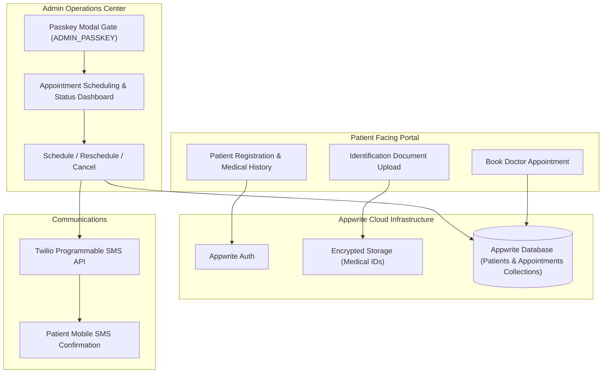

# 🏥 CarePulse: Modern Healthcare Patient Management System

[](https://nextjs.org)
[](https://react.dev)
[](https://www.typescriptlang.org)
[](https://tailwindcss.com)
[](https://appwrite.io)
[](https://www.twilio.com)
[](https://zod.dev)
[](LICENSE)

A full-stack, HIPAA-compliant patient management and appointment scheduling platform built with **Next.js**, **Tailwind CSS**, and **Appwrite**. CarePulse streamlines patient registration, physician booking, encrypted identification uploads, administrative schedule management, and automated SMS appointment confirmations.

---

## 🏛️ System Architecture & Workflow



---

## ✨ Core Features & Modules

### 1. 📋 Seamless Patient Registration & Onboarding
* **Comprehensive Intake**: Captures emergency contacts, insurance providers, policy numbers, medical history, past surgeries, and allergies.
* **Encrypted KYC Verification**: Secure file dropzone allowing patients to upload scanned identity documents (Driver's License, Passport, National ID) directly into private Appwrite Storage buckets.
* **Consent & HIPAA Compliance**: Electronic disclosure checkboxes and privacy consent validation enforced via **Zod** and **React Hook Form**.

### 2. 🗓️ Intelligent Appointment Booking
* **Physician Selection**: Choose from primary care physicians with specialty, avatar, and availability profiles.
* **Custom Scheduling**: Select target appointment dates, times, and provide specific visit reasons and clinical notes.
* **Instant Confirmation Receipt**: Interactive summary screen displaying doctor details, scheduled time, and confirmation badges.

### 3. 🛡️ Passkey-Protected Administrative Command Center
* **Security Gate**: Protected by a 6-digit administrative passkey OTP modal (`ADMIN_PASSKEY`) to prevent unauthorized staff access.
* **Real-Time KPI Tracking**:
  * 🟢 **Total Scheduled Appointments**
  * 🟡 **Pending Appointment Requests**
  * 🔴 **Cancelled Consultations**
* **Dynamic Status Controls**: Action modals enabling administrators to confirm, reschedule, or cancel patient requests in real time.

### 4. 📲 Automated SMS Notifications
* Integrated with **Twilio Messaging API** to trigger automatic SMS text confirmations directly to patient mobile numbers when their appointment is scheduled, modified, or cancelled.

---

## 📂 Project Organization

```
carepulse/
├── app/                        # Next.js App Router
│   ├── page.tsx                # Patient onboarding landing page
│   ├── layout.tsx              # Root HTML shell & ThemeProvider
│   ├── admin/                  # Protected administrative dashboard
│   └── patients/
│       ├── [userId]/register/  # Multi-step medical registration form
│       └── [userId]/new-appointment/ # Doctor appointment booking
├── components/                 # Reusable UI Primitives
│   ├── forms/                  # PatientForm, RegisterForm, AppointmentForm
│   ├── table/                  # Admin appointment data table & action cells
│   └── ui/                     # Radix UI + shadcn design system
├── lib/                        # Server Actions & Backend SDK
│   ├── actions/                # Appwrite server actions (patient, appointment)
│   ├── appwrite.config.ts      # Appwrite Client, Databases, and Storage instances
│   └── utils.ts                # Date formatters, class mergers (clsx, twMerge)
├── types/                      # TypeScript declarations & Appwrite schemas
└── constants/                  # Doctors list, blood types, form default values
```

---

## 🚀 Quick Start & Installation

### Prerequisites
* **Node.js**: v18.17+ or v20.x
* **npm** / **pnpm** / **yarn**
* **Appwrite Cloud Account**: Project ID, Database ID, and Storage Bucket ([appwrite.io](https://appwrite.io))
* **Twilio Account**: Account SID, Auth Token, and Phone Number ([twilio.com](https://twilio.com))

### 1. Clone & Install Dependencies
```bash
git clone https://github.com/kaizxark/carepulse.git
cd carepulse
npm install
```

### 2. Configure Environment Variables
Create a `.env.local` file in the root directory:
```env
# Appwrite Configuration
NEXT_PUBLIC_ENDPOINT=https://cloud.appwrite.io/v1
PROJECT_ID=your_appwrite_project_id
API_KEY=your_appwrite_api_key
DATABASE_ID=your_database_id
PATIENT_COLLECTION_ID=your_patient_collection_id
DOCTOR_COLLECTION_ID=your_doctor_collection_id
APPOINTMENT_COLLECTION_ID=your_appointment_collection_id
NEXT_PUBLIC_BUCKET_ID=your_storage_bucket_id

# Admin Security
NEXT_PUBLIC_ADMIN_PASSKEY=123456

# Twilio SMS Service
TWILIO_ACCOUNT_SID=your_twilio_account_sid
TWILIO_AUTH_TOKEN=your_twilio_auth_token
TWILIO_PHONE_NUMBER=+1234567890
```

### 3. Run Development Server
```bash
npm run dev
```
Open [http://localhost:3000](http://localhost:3000) in your browser.

---

## 📜 License & Author

Engineered by **Shaik Mohammed Ehtesham** ([@kaizxark](https://github.com/kaizxark)) under the **MIT License**.
